  

  

## About me

I'm Gabriele, a founder and self-taught developer from Rovigo, Italy.

I build **[FlashFX](https://flashfx.app)**, a motion graphics and video editor that runs entirely in the browser. More than 8,000 people have used it, and I have rebuilt it from scratch four times, alone.

- 🏆 **1st place at GNI 2026**, Italy's national informatics championship
- ⚡ Working on the FlashFX editor, FlashCC and the pipelines that produce FlashFX's own content
- ✍️ Writing how it is actually going, most days, on **[gabrielebolognese.blog](https://gabrielebolognese.blog)**
- 🧠 Mostly TypeScript, close to the GPU: WebGPU, WebCodecs, WGSL

## What I'm building

<table>
  <tr>
    <td width="50%" valign="top">
      <h3>⚡ <a href="https://github.com/gabrielebolognese/FlashFX-v2">FlashFX</a></h3>
      
A motion graphics studio rendered on WebGPU. Keyframes, expressions, a MoGraph cloner, 2D physics, more than 100 GPU effects, auto captions, and AI that generates scenes you can still edit.

      

        
        
        
      

      
<a href="https://editor.flashfx.app"><b>Open the editor →</b></a> · <a href="https://documentation.flashfx.app">Docs</a> · <a href="https://flashfx.app">Site</a>

    </td>
    <td width="50%" valign="top">
      <h3>🎬 <a href="https://github.com/gabrielebolognese/FlashFXeditor">Shorts Editor</a></h3>
      
A local-first video editor for Reels, TikTok and Shorts. Multi-track timeline, masks, captions and templates, with MP4, WebM and GIF export. Projects stay on your disk, and a CLI renders them headlessly.

      

        
        
        
      

    </td>
  </tr>
  <tr>
    <td width="50%" valign="top">
      <h3>🖼️ <a href="https://github.com/gabrielebolognese/FlashCC">FlashCC</a></h3>
      
Carousels for LinkedIn, Instagram and TikTok. Pick one of four content frameworks, draft the copy, then edit every slide on a layer-based canvas and export PDF or images.

      

        
        
        
      

    </td>
    <td width="50%" valign="top">
      <h3>🤖 <a href="https://github.com/gabrielebolognese/AutoFlashFX">AutoFlashFX</a></h3>
      
An unattended pipeline that turns a one-line idea into a finished reel: research, script, voiceover, motion graphics written as code, review and render. No AI video anywhere in it.

      

        
        
        
      

    </td>
  </tr>
  <tr>
    <td width="50%" valign="top">
      <h3>🪐 <a href="https://github.com/gabrielebolognese/Terraform">Terraform</a></h3>
      
A browser game about terraforming Mars. Order orbital machines, found cities, link them by rail and trade with Earth, all on top of a deterministic planetary simulation.

      

        
        
        
      

    </td>
    <td width="50%" valign="top">
      <h3>🏰 <a href="https://github.com/gabrielebolognese/civitasCraft">CivitasCraft</a></h3>
      
A Paper plugin for city-building Minecraft servers. Cities with claims and ranks, a coin economy, alliances, sieges, and week-long wars whose block damage is fully rolled back.

      

        
        
        
      

    </td>
  </tr>
  <tr>
    <td width="50%" valign="top">
      <h3>🗓️ <a href="https://github.com/gabrielebolognese/DigitalGabry">DigitalGabry</a></h3>
      
A local-first desktop planner: a week of time blocks, a content workspace, rule-based schedule generation and a momentum score of what actually got done.

      

        
        
        
      

    </td>
    <td width="50%" valign="top">
      <h3>🌳 <a href="https://github.com/gabrielebolognese/Knowledge-Tree">Knowledge Tree</a></h3>
      
An endless canvas for mapping a study journey. One tree per subject, a main rail with side branches, a vocabulary word cloud and math notation.

      

        
        
        
      

    </td>
  </tr>
</table>

**Also on here:** the [FlashFX landing page](https://github.com/gabrielebolognese/FlashFX-landing-page) and [documentation](https://github.com/gabrielebolognese/FFXdocumentation), [my personal site](https://github.com/gabrielebolognese/gabriele), a [Pinterest autoposter](https://github.com/gabrielebolognese/pinterestPoster) that runs on GitHub Actions, and the first two FlashFX builds ([Alpha](https://github.com/gabrielebolognese/FlashFX-Alpha), [MVP](https://github.com/gabrielebolognese/FlashFX_MVP)), kept for history.

## Tech stack

  
   
  

## GitHub activity

  

## Find me

  

